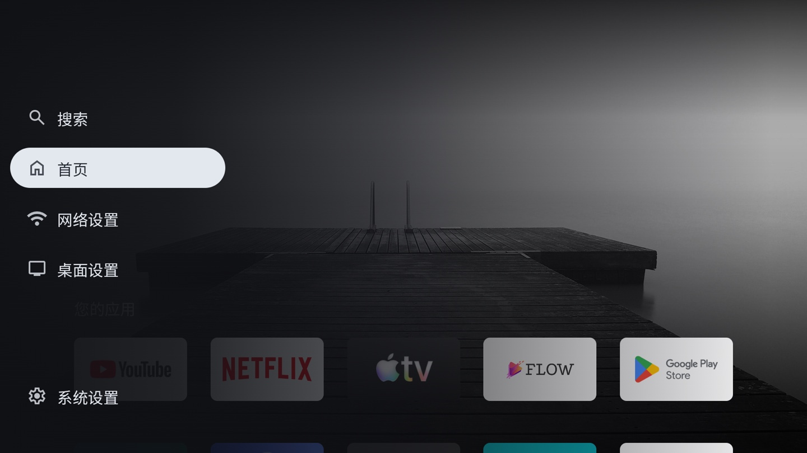

# Railnest TV

[简体中文](README.md) · [Releases](https://github.com/carbonduke/railnest-tv/releases) · [Installation prompt (Chinese)](prompt.md)

Railnest TV is an open-source Android TV launcher made for a remote. It uses Android TV Material components for its Home screen, navigation drawer, app library, and settings. It is a fork of [Aerial TV](https://github.com/pengchujin/aerial-tv).

## What you can do

- Browse installed apps or search for them by name. Move, hide, or inspect an app from its long-press menu.
- Open network and system settings from the left navigation drawer.
- Choose one of ten bundled wallpapers or upload a photo from a phone or computer on the same local network.
- Adjust the app layout, labels, and animations. Lock the layout when you are happy with it.
- Open the system screensaver settings and start the screensaver when the firmware exposes that action.
- Use the launcher in Simplified Chinese, English, Russian, Ukrainian, or Kazakh. The TV uses its system language.

## Install and try it

Version 0.1 targets Android 8.0 (API 26) and later, with ARM 32-bit and ARM 64-bit libraries in one APK. The development build was tested on a Xiaomi TV Stick MiTV-AFMU1, running Google TV 14.

Install the APK from [Releases](https://github.com/carbonduke/railnest-tv/releases) through a supported package installer or ADB. First open Railnest TV from the existing app list. Press Left from the first app in any row to open the drawer. Choose **Desktop settings → Set Railnest TV as default Home** to open the system picker. Use the physical Home button to verify the selection. You can select the original launcher in the same picker.

On some firmware, the original launcher still responds to Home even after Android saves the new selection. Startup, standby, and system screensaver behavior vary by device. See [the operation and device notes](docs/RAILNEST-TV.md).

## Build from source

Use JDK 17 and Android SDK 36. Run `./gradlew :app:assembleStandardDebug` from the repository root. The APK is created under `app/build/outputs/apk/standard/debug/`.

## Maintenance and credits

[carbonduke](https://github.com/carbonduke) maintains Railnest TV. OpenAI Codex assisted with implementation and testing. The code retains the [MIT license and upstream copyright notices](LICENSE). [CleanYourTV](https://github.com/Gathin23/cleanyourtv) informed device compatibility and recovery documentation. The [third-party notices](app/src/main/assets/licenses/THIRD-PARTY.md) and [wallpaper credits](app/src/main/assets/figma-wallpapers/SOURCES.md) list content licenses and authors.

Use [Issues](https://github.com/carbonduke/railnest-tv/issues) to report device compatibility or bugs. Include the device model, firmware, Android version, CPU ABI, and steps to reproduce.
