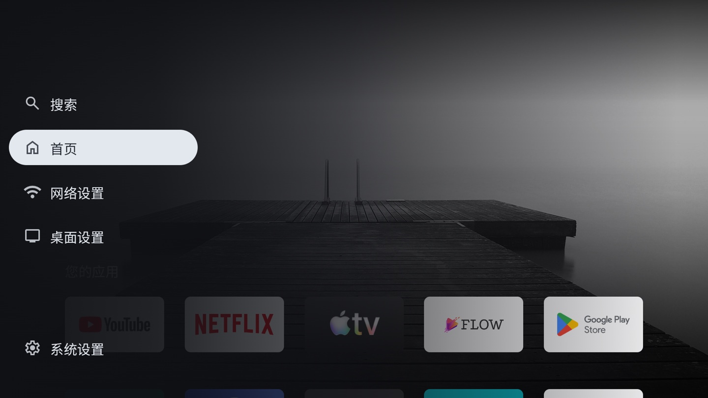
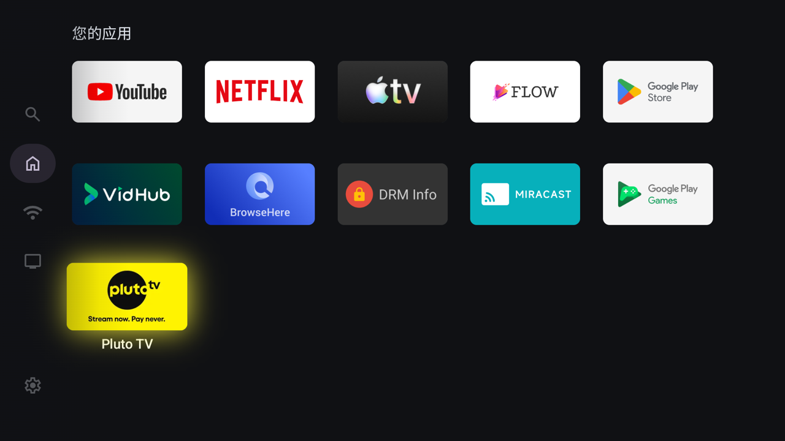
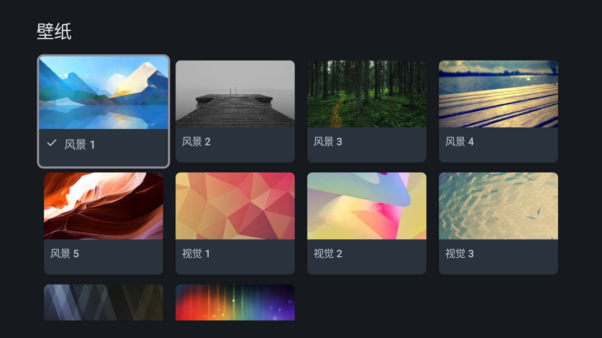
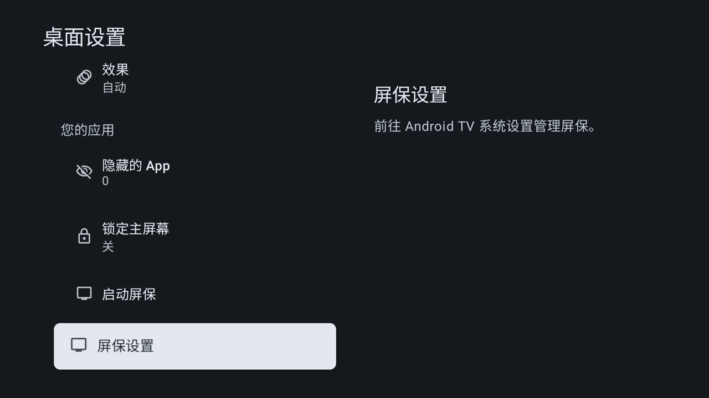

# Railnest TV

Railnest TV 是一款为遥控器设计的开源 Android TV 桌面。打开 Railnest TV 后，可以从自选壁纸和应用入口开始浏览。首页、导航夹和设置采用 [Android TV Material 组件](https://developer.android.com/design/ui/tv)，界面随电视系统语言切换。项目基于 [Aerial TV](https://github.com/pengchujin/aerial-tv)。

[查看 Releases](https://github.com/carbonduke/railnest-tv/releases) · [安装提示词](安装提示词.md) · [操作说明](docs/RAILNEST-TV.md) · [反馈设备兼容性](https://github.com/carbonduke/railnest-tv/issues)



| 应用库 | 壁纸图库 | 桌面设置 |
| --- | --- | --- |
|  |  |  |

*图片来自小米电视棒 MiTV-AFMU1 的开发版实机测试。应用库显示设备上可启动的应用，截图中的第三方应用取决于该设备的安装情况。*

## 主要功能

| 功能 | 可以做什么 |
| --- | --- |
| 首页和导航夹 | 首页显示自选静态壁纸、应用和时间。从每行第一个应用向左按，打开导航夹。导航夹提供搜索、首页、网络设置、桌面设置和系统设置。 |
| 应用库与搜索 | 从首页向下浏览可启动的应用，或从导航夹按名称搜索。电视已安装 Google Play 商店且提供启动入口时，可在应用库中打开。 |
| 应用管理 | 长按应用打开操作菜单，然后选择移动、隐藏或查看应用信息。隐藏的应用可从桌面设置中恢复。 |
| 静态壁纸 | 内置五张风景和五张视觉类壁纸。也可以在同一局域网内用手机或电脑上传照片，上传多张后可选择轮播。 |
| 桌面设置 | 调整每行应用数量、单排或双排布局、应用名称和动效，或锁定首页布局。移动遥控器焦点时，右侧会显示当前项目的说明或预览。 |
| 系统屏保 | 支持从桌面设置打开原生屏保设置。在固件允许时，可以立即启动屏保，也可以在首页首屏按返回键进入屏保。 |
| 语言 | 电视端跟随系统语言，提供简体中文、英文、俄语、乌克兰语和哈萨克语。扫码壁纸页的按钮和提示跟随浏览器语言。 |

## 兼容性与测试范围

- **系统**：Android TV、Google TV 和允许安装 Android APK 的厂商系统。0.1 的最低版本为 Android 8.0（API 26）。Tizen、webOS 和 Roku OS 无法运行 Android APK。
- **架构**：同一个 APK 支持 ARM 32 位（`armeabi-v7a`）和 ARM 64 位（`arm64-v8a`）。部分 64 位电视芯片搭配 32 位 Android，请以设备实际报告的 ABI 为准。
- **实机验证**：小米电视棒 MiTV-AFMU1（Google TV 14）。开发版已验证首页、应用库、桌面设置和调用系统氛围屏保。0.1 已核验最低 SDK 和两套 ARM 原生库，其他机型和 Android 版本仍需实测。
- **系统限制**：安装、默认桌面、实体 Home 键、开机和待机唤醒的表现因固件而异。MiTV-AFMU1 上已见到系统选择器保存 Railnest TV 后，实体 Home 和重启仍由 Google TV 接管的情况。

## 安装与首次使用

1. 从 [GitHub Releases](https://github.com/carbonduke/railnest-tv/releases) 下载对应版本。若发布页提供了 SHA-256 校验文件，先核对下载得到的 APK。
2. 通过电视允许的本地 APK 安装方式安装，或使用 ADB。使用 ADB 前，请在电视上确认调试授权，并用 `adb devices -l` 核对要操作的设备。
3. 安装后，从电视原桌面的应用列表打开 **Railnest TV**。先检查方向键、应用启动、网络和系统设置。
4. 如希望切换默认桌面，打开「桌面设置 → 将 Railnest TV 设为默认桌面」。在系统选择器中选定后，按实体 Home 键验证。要恢复原桌面，可在同一选择器里重新选回原厂桌面。

如果要让助手指导安装，可复制[通用安装提示词](安装提示词.md)。其中包含设备识别、ABI 检查、安装失败时的判断和默认桌面的恢复步骤。

### 遥控器操作

| 操作 | 按键 |
| --- | --- |
| 浏览完整应用库 | 在首页按方向键「下」 |
| 打开导航夹 | 聚焦每行首个应用后按左。带菜单键的遥控器也可以按菜单键 |
| 返回应用区 | 在导航夹按右或返回 |
| 移动应用 | 在应用卡片上长按确认键，松开后选择「移动」 |
| 尝试启动系统屏保 | 在首页首屏按返回，或从桌面设置选「启动屏保」 |

### 更换壁纸

在「桌面设置 → 壁纸」中直接选择内置图片。使用自己的照片时，打开「用手机或电脑设置」，再用同一局域网里的手机扫描二维码，或在电脑上打开电视显示的地址。把设置页链接当作临时访问凭证，分享截图前请遮住二维码和地址。

## 从源码构建

准备 JDK 17 和 Android SDK 36，在仓库根目录运行：

```bash
./gradlew :app:assembleStandardDebug
```

生成的 APK 位于 `app/build/outputs/apk/standard/debug/`。用于分发的 APK 需要项目发布签名。Android 会校验更新包的签名，在测试版和发布版之间切换前请先备份需要保留的设置和壁纸。

## 项目维护与开发

- **项目维护**：[carbonduke](https://github.com/carbonduke)
- **开发协助**：OpenAI Codex，参与 Railnest TV 的界面实现、代码修改和测试。
- **项目来源**：Railnest TV 直接 fork 自 [Aerial TV](https://github.com/pengchujin/aerial-tv)，沿用上游的应用目录、壁纸引擎和部分设备适配。Railnest TV 增加和改造了 Material 首页、左侧导航夹、应用搜索、桌面设置和静态壁纸流程。

## 许可证与素材署名

- 项目代码采用 [MIT 许可证](LICENSE)。Aerial TV 原有代码的版权归 pengchujin 和相关贡献者，原始版权和许可声明随源码及 APK 保留。Railnest TV 的新增代码由相应贡献者保留版权，并沿用 MIT 许可证。
- 发版与真机验证流程参考 [CleanYourTV](https://github.com/Gathin23/cleanyourtv) 的机型笔记、ADB 诊断和桌面恢复流程。该项目由 Gathin 及相关贡献者维护。
- [Inter](https://github.com/rsms/inter) 字体归 Inter Project Authors，采用 [SIL Open Font License 1.1](FONT-LICENSE-OFL.txt)。[Material Symbols](https://github.com/google/material-design-icons) 图标由 Google 提供，采用 Apache 2.0。项目图标使用由 [Material Color Utilities](https://github.com/material-foundation/material-color-utilities) 生成的深色配色。
- 内置壁纸来自 Android Open Source Project Launcher2 和 KDE Plasma 壁纸库。原图、作者、裁切说明和对应许可见[壁纸署名](app/src/main/assets/figma-wallpapers/SOURCES.md)。上游保留的 [GeoNames](https://www.geonames.org/) 城市数据采用 CC BY 4.0。完整[第三方许可声明](app/src/main/assets/licenses/THIRD-PARTY.md)随 APK 分发。
- 截图中的第三方应用图标和商标归各自权利人。Railnest TV 是独立项目，与 Google 或电视制造商没有隶属或背书关系。

## 反馈与贡献

欢迎在 [Issues](https://github.com/carbonduke/railnest-tv/issues) 分享实测结果或提出改进。报告兼容性时，写明电视型号、Android 版本、固件号、ABI、Railnest TV 版本、安装方式和复现步骤。反馈 Home 行为时，请分别记录实体 Home、重启、从桌面唤醒和从其他应用唤醒的结果。

公开截图或日志前，请遮住本地 IP、Wi-Fi 名称、账户信息和二维码链接。提交代码时请说明改动和验证方式，并遵守 [GitHub 社区指南](https://docs.github.com/en/site-policy/github-terms/github-community-guidelines)。
