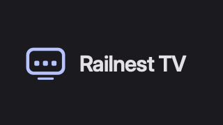

# Railnest TV

Railnest TV 是一个面向遥控器操作的 Android TV 桌面。它基于 [Aerial TV](https://github.com/pengchujin/aerial-tv)，采用 [Android TV 的 Material 设计指南](https://developer.android.com/design/ui/tv)组织首页、应用库和设置。首页使用你选择的静态壁纸。

## 功能

- 使用遥控器浏览和搜索已安装、可启动的应用。设备安装了 Google Play 商店时，可从应用库打开。
- 左侧导航夹提供搜索、首页、网络设置、桌面设置和系统设置。
- 从十张内置静态壁纸中选择，或通过同一局域网内的手机或电脑上传照片。
- 设置首页行列、动画和应用名称的显示方式。长按应用可进入菜单，再选择移动、隐藏或查看应用信息。
- 在支持的固件上启动系统屏保、打开原生屏保设置，或通过系统选择器将 Railnest TV 设为默认桌面。

## 兼容性

0.1 面向 Android 8.0（API 26）及以上，同一个 APK 支持 ARM 32 位（armeabi-v7a）和 ARM 64 位（arm64-v8a）。请以电视实际报告的 ABI 为准，部分 64 位芯片运行的是 32 位 Android 系统。Tizen、webOS、Roku OS 等系统无法运行 Android APK。

此前的开发版已在小米电视棒 MiTV-AFMU1（Google TV 14）验证首页、应用库、桌面设置及系统氛围屏保。0.1 的最低 SDK 和两种 ABI 已在安装包中核验。其他机型和 Android 版本还需实测。屏保入口、实体 Home 键和开机唤醒由固件决定。MiTV-AFMU1 上，系统可以记住 Railnest TV 的选择，但原版 Google TV 桌面仍可能优先响应 Home。可以先把 Railnest TV 当普通应用打开。

## 安装

从本项目的 Releases 获取 **Railnest TV.apk**，使用电视允许的本地 APK 安装方式，或按[安装提示词](安装提示词.md)使用 ADB。首次安装后，从电视的应用列表打开 Railnest TV。如需尝试接管 Home，前往「桌面设置 → 将 Railnest TV 设为默认桌面」。如需恢复，在系统的默认桌面设置中重新选择原厂桌面。

## 来源与授权

- 直接 fork 自 [Aerial TV](https://github.com/pengchujin/aerial-tv)。原有代码版权归 pengchujin 及相关贡献者，沿用上游 MIT 许可证，分发时随附原始版权与许可声明。本 fork 新增代码由相应贡献者保留版权，并按仓库 MIT 许可证发布。 [上游许可证](https://github.com/pengchujin/aerial-tv/blob/main/LICENSE)
- [CleanYourTV](https://github.com/Gathin23/cleanyourtv) 由 Gathin 及相关贡献者维护，是机型适配、ADB 诊断、默认桌面验证与回退流程的参考资料。
- [Inter](https://github.com/rsms/inter) 归 Inter Project Authors，采用 SIL Open Font License 1.1。[Material Symbols](https://github.com/google/material-design-icons) 由 Google 提供，采用 Apache 2.0。
- 内置壁纸来自 Android Open Source Project Launcher2 和 KDE Plasma 壁纸库。[壁纸来源与作者](app/src/main/assets/figma-wallpapers/SOURCES.md)列明了每张图片的作者、来源和上游授权。裁切与缩放后的图片继续适用其原有授权。[第三方许可声明](app/src/main/assets/licenses/THIRD-PARTY.md)也随 APK 分发。
- 项目图标由 Railnest TV 项目制作，雾蓝配色由 [Material Color Utilities](https://github.com/material-foundation/material-color-utilities) 生成。
- 上游保留的 [GeoNames](https://www.geonames.org/) 城市数据采用 CC BY 4.0。系统和已安装应用提供的图标、品牌及商标归其各自权利人。

Railnest TV 是独立项目，与 Google 或电视制造商没有隶属或背书关系。

## 反馈

欢迎提交兼容性报告。请注明设备型号、Android 版本、固件号、ABI、安装方式和复现步骤。反馈 Home 行为时，请分别记录实体 Home、系统重启，以及从桌面和应用内待机唤醒的结果。公开日志前请移除 IP、Wi-Fi 名称、账户信息及二维码链接。请遵守 [GitHub 社区指南](https://docs.github.com/en/site-policy/github-terms/github-community-guidelines)。
